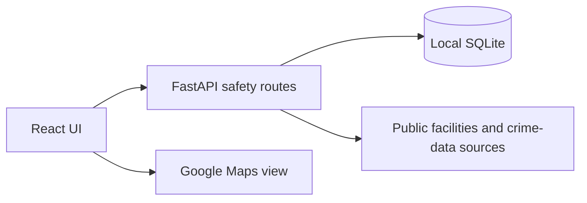

# SHEild

**A public-safety and crime-awareness prototype for Amritsar.**

SHEild combines a React/TypeScript interface with a FastAPI/SQLite backend for
public facility maps, source-linked historical crime data, trusted contacts
and incident-report learning workflows. It is a hackathon prototype, not a
phishing detector, crime predictor or verified emergency-response system.

## Features and boundaries

- Map/facility information from OpenStreetMap-backed services and a Google Maps view.
- Historical crime information with source/date/geographic limitations.
- Contact and incident-report CRUD for a local lab.
- Remaining DNS/HTTP/TLS research helpers are not proof of an active scam-detection feature.
- ChatGPT-assisted development is distinct from runtime AI: a deployed OpenAI
  integration is not a verified current feature.

## Local setup

Install Python with virtual-environment support, Git and Node.js/npm. Use a
disposable local lab and synthetic contact/report data.

```sh
git clone https://github.com/Yuvraj-26-k/SHEild.git
cd SHEild
```

Backend, from the repository root on Windows:

```powershell
py -m venv .venv
.\.venv\Scripts\python.exe -m pip install fastapi uvicorn httpx dnspython certifi
.\.venv\Scripts\python.exe -m uvicorn app.main:app --app-dir backend --host 127.0.0.1 --port 8000
```

On Linux/macOS, create the environment with `python3 -m venv .venv` and use
`.venv/bin/python` in place of the Windows interpreter path. There is no tracked
backend requirements file yet; the command lists packages used by the reviewed
Python modules. A pinned dependency manifest and clean-install verification are
still needed.

Frontend, in a second terminal:

```sh
cd frontend
npm install
npm run dev -- --host 127.0.0.1
```

Set `VITE_GOOGLE_MAPS_API_KEY` in a local `frontend/.env.local` file for the map
view. Use an appropriately restricted browser key and never commit private
credentials. The browser calls the backend at `127.0.0.1:8000`. External data
services require connectivity and can be unavailable or incomplete.

## Architecture



`backend/app/main.py` is the active entry point. The two registered routers
currently overlap on contact/report paths; resolving that ambiguity is a
known implementation task. Source dates and approximate locations must remain
visible; the map does not establish that a locality is unsafe.

## Security, privacy and status

The reviewed contact/report endpoints do not implement per-user authorization.
Keep the app local; do not enter real contacts, private incident information or
client data. The audited tracked database was empty, but runtime writes can
introduce personal information. Do not mistake a local prototype for a secure
multi-user service.

Tracked dependencies/bytecode and duplicate routes remain in source; this
documentation change does not remove or fix them. `Cyber.py` is empty. There
are no first-party tests, and no sanitized application screenshot has been
verified for this README. `npm run build` and `npm run lint` are available in
`frontend`; a successful build alone would not validate external data sources.

Next priorities: authorization and data lifecycle, route deduplication, pinned
backend dependencies, clean installs, synthetic fixtures and a documented demo.
